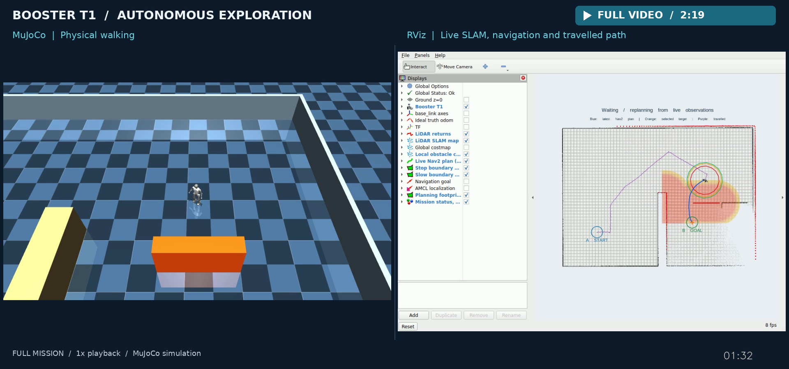
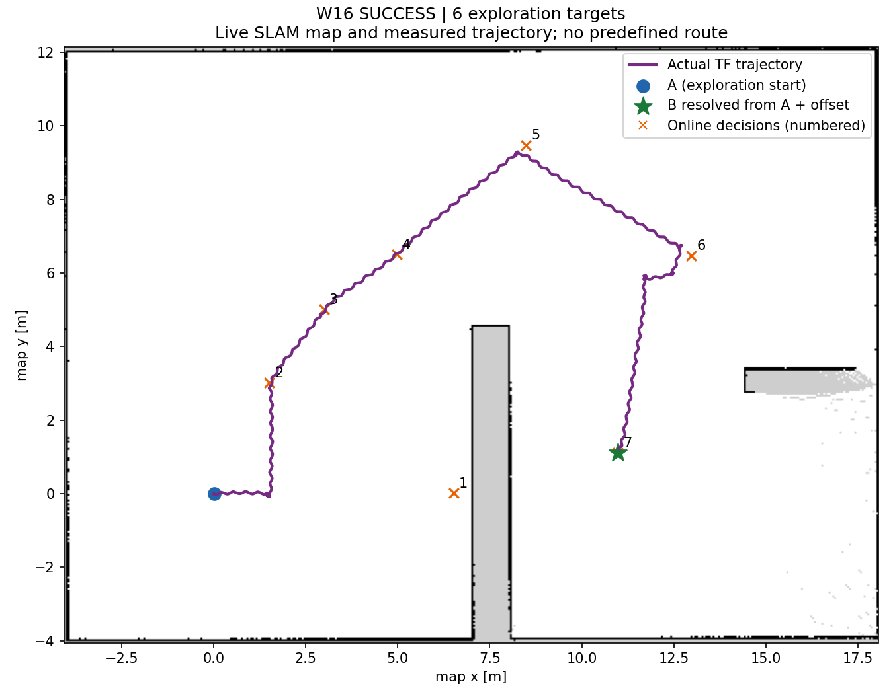

# Humanoid Navigation with Booster T1

**Give the robot a destination. Let it discover the route and walk there.**

A ROS 2 and MuJoCo project connecting physical bipedal locomotion, LiDAR SLAM, goal-directed exploration, and Nav2. Starting with a relative goal, the T1 builds a map, selects observation targets, finds a route through observed free space, and responds to moving obstacles along the way.

[](https://github.com/wandering2025/humanoid_nav_ws/releases/download/demo-2026-10-23/booster-t1-full-mission.mp4)

**[Full mission video — 2:19, MP4](https://github.com/wandering2025/humanoid_nav_ws/releases/download/demo-2026-10-23/booster-t1-full-mission.mp4)** · MuJoCo and RViz side by side, from mission readiness to arrival and standstill, at 1× playback. Recorded on October 23, 2026.

The robot discovers the route, walks around the wall, waits for a moving obstacle, and continues to the destination. [Video and run evidence](https://github.com/wandering2025/humanoid_nav_ws/releases/tag/demo-2026-10-23).

## Core capabilities

- **Navigation grounded in a walking robot.** The official T1 policy drives joint targets and PD torques at 500 Hz physics / 50 Hz policy rates. A calibrated gait adapter connects Nav2 requests to the measured walking and turning envelope.
- **A destination is enough.** The explorer scores reachable frontiers by travel cost, progress toward the goal, information gain, and visit history. It switches to the destination as soon as an observed route becomes available.
- **Separate perception paths for mapping and obstacle response.** An observation-history filter removes transient returns from the SLAM input. Nav2 and Collision Monitor retain the unfiltered scan, keeping moving obstacles visible to the command chain.
- **Results tied to physical execution.** Each run records decisions, map snapshots, trajectories, contacts, arrival error, and process exits. An evaluator checks these independently of the navigation controller.

The project focuses on the engineering boundary between a learned walking policy and a classical navigation stack: turning perception and plans into executable humanoid motion.

## Demonstrated behavior

In the video above, the robot received **B = (+11.0, +0.5) m relative to its starting frame**. It selected six exploration targets and walked a **28.63 m** route through observed free space to B.

| Measurement | Recorded result |
| --- | ---: |
| Selected paths checked against their observed costmaps | 7 / 7 |
| Stationary wait during the obstacle encounter | 14.00 s |
| Travel after the obstacle withdrew | 6.27 m |
| Maximum goal error during the final two seconds | 0.110 m |
| Environment / obstacle contacts; falls | 0; 0 |



[Recording verification](docs/validation/full-mission-video.json) ties the video to its source revision, physical results, and all 18 GUI audit checks. [Run evidence and validation](docs/validation.md) also covers the static control, alternate layouts, and load tests. The simulation uses ideal odometry and attitude compensation; world geometry and obstacle trajectories stay outside the exploration and planning interfaces.

## Quick start

Use **Ubuntu 24.04, ROS 2 Jazzy, Python 3.12, and MuJoCo 3.15.0**. Follow the [one-time setup](docs/setup.md) to install the pinned Booster dependencies and build the four ROS packages.

From the repository root, with `T1_VENV`, `T1_UPSTREAM`, and `T1_ASSETS` configured:

```bash
# Check the environment and calibrated runtime files.
./scripts/run_exploration_demo.sh --preflight

# Run the complete mission without windows.
./scripts/run_exploration_demo.sh --headless

# Open MuJoCo + RViz on the documented WSL2 / NVIDIA display profile.
./scripts/run_exploration_demo.sh
```

Set the destination in [exploration_task.yaml](src/t1_navigation/config/exploration_task.yaml):

```yaml
schema: 1
frame: start
goal: {x: 11.0, y: 0.5}  # metres: forward, left
```

Changes apply on the next run. Add `--static` for the obstacle-free control or `--hold` to keep the final view open. **Ctrl+C requests a latched stop and cleans up the run's processes.** Results are written to `run_data/exploration/<run-id>/final-result.json`.

## System architecture


The blue path keeps unfiltered scans available to costmaps and Collision Monitor. The green loop returns the final command to the walking policy. [View the vector diagram](docs/media/system-architecture.svg).

| Package | Responsibility |
| --- | --- |
| `t1_mujoco` | Physics, policy execution, calibration, LiDAR, and ROS state |
| `t1_description` | Robot model integration, footprint, and visualization |
| `t1_navigation` | SLAM, localization, planning, controller, and safety configuration |
| `t1_bringup` | Launch composition, exploration algorithms, and command ownership |

[Architecture](docs/architecture.md) · [Setup and commands](docs/setup.md) · [Validation](docs/validation.md) · [Development](CONTRIBUTING.md)

## Credits and license

Project integration includes the simulator/ROS bridge, gait calibration, compensated LiDAR, exploration manager, scan filter, command supervision, and evaluation tools. Robot models and the pretrained walking policy come from **Booster Robotics**; mapping and navigation use **SLAM Toolbox** and **Nav2**.

Project code is licensed under [Apache 2.0](LICENSE). External models, policies, and libraries retain their respective licenses; see [third-party notices](THIRD_PARTY_NOTICES.md).
