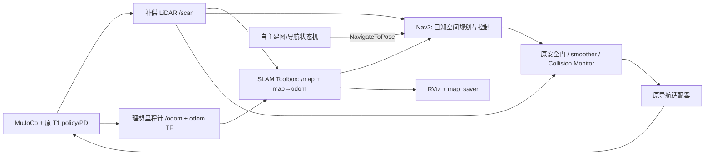

# Advanced SLAM and Navigation Demo v0.2 架构与限制

本阶段独立于 demo-v0.1.0；最终验收和可追溯证据见 [release-manifest.md](release-manifest.md)。新阶段授权只覆盖高级分支/worktree，未改写稳定历史、旧入口或外部上游。

## 真实能力与方案

只读审查确认 v0.1 使用物理 T1 步行、补偿 LiDAR、保存的 SLAM 地图、AMCL/Nav2、动态障碍安全等待及进程清理。旧建图实验是指令序列，不是自主探索。

v0.2 选择 **guided autonomous mapping**：预定义 map 坐标航点由 Nav2 自主执行。初始启动空白 SLAM Toolbox 会话，没有加载先验地图；NavFn 保持 `allow_unknown:false`。近距离航点让机器人先观测、再逐步进入新区域。9 个建图航点经过西区、北廊、东区后回 A，保存真实 `/map`，再导航到 B。整个过程 SLAM 是唯一 map→odom 发布者，不切换 AMCL。

演示阶段为启动/自检→SLAM 初始化→MAPPING_01…09→返回 A/保存地图→启用障碍实验→A 到 B 导航→到达验证→锁存停车/物理静止→退出/端口释放。中断先锁存停车，再通过 action 服务取消活动目标，等待工具返回 CANCELED；有界清理保留所有真实退出码。取消不会重新 arm。

## 场景、路线和数据所有权

| 项目 | 实现 |
|---|---|
| 空间 | 外围 x=[−4,18]、y=[−4,12]；隔墙 x=[7,8]、y=[−4,4.5]，高 1.5m |
| 宽度 | 北侧通道 7.5m；复杂度来自遮挡、区域和转弯 |
| A/B | A=(0,0,0)，B=(14,0,−π/2)，B 被隔墙遮挡 |
| 航点 | (3.5,0)→(3.5,3.5)→(3.5,7.8)→(7.5,8)→(11.5,8)→(14,4)→(12.5,8)→(3.5,8)→A；朝向见 advanced_route.yaml |
| 障碍 ADV01 | 建图后显式启用；机器人 x≥10 且前进指令>0.1 时触发。0.5×0.5×1.5m 箱体从(17.2,5)以0.6m/s靠近(14,5)，停6s，原速撤离 |
| 规划信息 | 只接收地图、扫描与 TF；不读取障碍真值或未来轨迹。实验事件用姿态触发；真值仅供独立评测 |
| 地图保存 | Nav2 map_saver 从 SLAM `/map` 保存 initial/mapped/final PGM/YAML；sidecar 绑定 run ID、源码/场景/SLAM 参数哈希和实际 TF。保存地图不被重新加载到导航 |
| 可视化 | A/B 仅在 MuJoCo user_scn 和 RViz；材质仅作用于显示模型副本。CPU 测试核对物理几何、动力学、ray 结果不变 |
| 命令与时间 | `/cmd_vel` 唯一输出为 Collision Monitor；导航适配器及命令映射不变；ROS 节点使用仿真时钟；窗口心跳用单调时钟判断同一3s期限 |

原 policy/PD、runner、导航适配器、目标验证工具、safety.py、navigation.yaml、safety.yaml、command_map.yaml 和 run_demo.sh 均与稳定 tag 字节一致。规划半径2.05m、停车1.65m、减速1.95m、膨胀2.6m，以及原跌倒/停稳/超时阈值保持不变。物理运动从未通过编辑 base pose 替代。

高级 gate 只增加顺序退出包装：复用原 SafetyGate，在 ROS context 有效时结束回调并发布原关闭 veto，再销毁节点。TF 观察器复用 W09 的实际 RMW publisher GID 查询（Jazzy Python MessageInfo 不提供该字段），增加相同的信号标志/顺序退出；W09 历史源文件不变。二者都不改变控制律。

## 验证边界

完整演示必须同时满足：9 个建图目标及最终目标验证、地图增长、非直线路径、真实扫描与 costmap 标记、可测量的障碍响应、到达及停稳、四项零接触/跌倒、正确 TF/command/truth 所有权、仿真时钟无回退、全部组件退出0、无残留/端口可重用、无新图形监控故障。

动态响应接受保护等待后继续，或障碍活跃期间规划相对事前路径偏移≥0.5m、机器人实际偏移≥0.25m且行进≥0.5m。两者都要求≥3帧扫描命中、≥2帧局部 costmap 标记、障碍结束及到达。这是行为证据判据，没有降低安全阈值。第一轮成功运动但不满足旧“必须等待”判据的 FAILED 结果保持原样。

CPU 构建/契约→自主无界面运行→最小图形负载→完整双窗口→独立窗口读取→离线 CPU H264 编码/逐帧解码/关键阶段视觉检查。失败尝试全部保留。进程按 PID 和启动时间登记，退出仅处理本次任务；TCP TIME_WAIT 最多等待65s，不杀无关进程。

## 已知限制

- 理想真值里程计与真值姿态 LiDAR 补偿仍在使用；不是未知环境下真实传感器定位性能证明。LiDAR 为有限9×360射线、10Hz、1cm噪声的模拟器。
- 预定义地图坐标航点依赖设计好的宽敞平地场景与已知坐标，不是 frontier exploration；固定 ADV01/seed4000 演示不等同于任意建筑探索。
- 不可推动的 mocap 障碍、响应式 Nav2，没有轨迹预测或人体交互保证。机体最近间距以10Hz碰撞几何采样，不能解释为连续时间距离下界。
- 原步态存在速度死区与停步回弹；目标工具保留已有分段接近与停稳验证。没有重新训练或大规模重写步行控制。
- GPU 使用已冻结 WSLg/Mesa 的 NVIDIA OpenGL 路径，底层仍经 WSLg D3D12；不是原生 Linux OpenGL/CUDA 仿真。策略推理保持原 CPU 路径。未改驱动、显示设置或依赖。监控不能保证宿主图形故障隔离。
- 录像4fps、无音频，左右窗口顺序读取存在记录在案的时间差；不加速仿真片段，末尾证据卡为明确标记的后处理内容。
- 外部 Fast DDS 关闭 SIGSEGV 的历史风险没有被宣称修复。中断负测曾观察到−11，失败及精确退出码均保留；最终完整运行要求所有组件0，不使用 v0.1 的 DDS_TEARDOWN_EXCEPTION 放行。主动取消的任务结果应为 FAILED/CANCELED，不能算到达成功。
- 历史 W13 正式结果仍为 **FAILED/36/40**；v0.2 验证针对本次演示目标，不是新的可靠性研究或安全认证。

## SLAM 退出时序

完整录像01的实际任务通过，但 SLAM Toolbox 在 SIGINT 后抛出 context 已失效的等待异常并退出−6，故整轮 FAILED，原帧保留且未放行编码。安装版本2.8.5的[上游实现](https://github.com/SteveMacenski/slam_toolbox/blob/2.8.5/src/slam_toolbox_common.cpp#L163-L213)在 deactivate 中中断并 join 后台线程，cleanup 释放地图与 TF 对象。高级入口在物理停稳后、ROS context 仍有效时请求这两个生命周期转换并确认状态，再按原有登记进程顺序退出；转换不成功仍判失败。没有修改已安装 SLAM、ROS 或 DDS 库。
