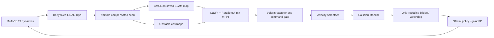

# Presentation notes

“This demo uses the Booster T1, MuJoCo, simulated LiDAR, and ROS 2 Jazzy. The robot walks through contact dynamics using an official pretrained locomotion policy. There is no base-pose animation or teleoperation.”

**What the audience sees.** Start at the cyan A marker, walk toward green B, observe an orange obstacle approaching the route, safely wait, resume after clearance, and stand at B. U01 demonstrates reactive stop-and-resume. It is not the sustained-blocking detour case. The independent B01 control separately demonstrated a physical detour.

**Why these choices.** MuJoCo gives actual biped contact dynamics with an already available T1 policy. ROS 2/Nav2 separates localization, planning and protective command handling. The map was produced from simulated LiDAR using SLAM Toolbox; the live demo loads that map and uses AMCL. It does not run live SLAM and AMCL as competing map→odom owners.

**Perception and information boundaries.** The scanner casts 9 × 360 geometric rays against the actual environment, including mocap obstacle geometry. Attitude compensation removes body tilt for planar navigation. The planner receives scan/costmaps, not obstacle truth or future trajectories. Ground truth is used for ideal odometry, attitude compensation and independent evaluation; these are explicit simulation simplifications.

**Practical challenges.** The walking policy has a low-speed deadband and imperfect yaw/stop response. Command adaptation happens before final collision filtering; the last bridge cannot turn zero into motion or increase a safety-limited command. Watchdogs handle stale commands and scans. Separate physical and viewing state prevent mouse/camera operations from moving the robot. The recovered graphics path uses the proven production close/join lifecycle, restrained annotations and independent CPU recording.

**Measured result.** Final recorded run: 46.4 simulated seconds from accepted navigation to verified goal, position error0.124m, yaw error2.22°, actual protective hold 7.08 s, zero contacts/falls, safety stop and complete cleanup, all component exits 0. The 1.444m minimum body clearance is sampled at10Hz, not a continuous guarantee.

**Honest limits.** Ideal odometry; truth attitude; finite, default noiseless beams; flat wide corridors; kinematic obstacles; no motion prediction; timing-sensitive planning/gait behavior; no physical robot or certified safety validation. W13 remains FAILED: static 10/10, crossing 8/10, blocking 8/10, sudden approach 10/10, total 36/40. The W15 B01 timeout is retained; a single unchanged-case recovery control passed, so no deterministic regression was reproduced and no new reliability rate is claimed.

**Engineering evidence.** The first W15 static checker crashed in NVIDIA's user-mode library. That failed custom path was not reused; the original branch and evidence remain. The recovered production chain passed a standing stage and complete demonstrations. One recording attempt captured zero frames before window readiness; that failure is retained and the corrected recorder waits for completed screenshots. DDS can still exit−11 during expected teardown; only the existing14-condition exception can classify that warning. Monitoring is not host fault isolation.

[Release identifiers and movie](release-manifest.md) · [Architecture constraints](architecture-and-limitations.md).
