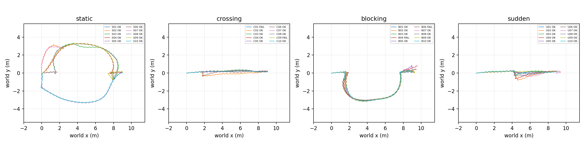

# W13 固定40例导航评测

状态：**FAIL**。完整40例；未缩减样本。只执行W13，W14未启动。

正式注册/被测起始提交：`a8e3c6a2bf5e73a4310f3f40c35934b534899140`；全套source/config内容指纹`2b8c5b71825db1b3d0c6afe5a267421f0741d858e01256a3916205a10cbdb5d7`。各run完整SHA、实际dirty、参数/地图/策略哈希见[结果来源](../evidence/W13/formal-v1/summary.json)及逐run JSON。

| 类别 | 实际到达/总数 | 门槛 | 结果 |
|---|---:|---:|---|
| static | 10/10 | ≥10/10 | PASS |
| crossing | 8/10 | ≥9/10 | FAIL |
| blocking | 8/10 | ≥9/10 | FAIL |
| sudden | 10/10 | ≥9/10 | PASS |

每例均完整重启MuJoCo/策略、ROS节点/TF缓存、AMCL和costmap；种子、起终点及障碍速度/触发/停留时间在正式运行前登记于test_suite_v1.yaml和w13_events_v1.yaml。S01–S05保留W11五条路线，S06–S10重复路线但采用新种子；没有删行或失败后换路线。MPPI/ROS调度存在非确定性，种子不保证逐位重放。

判据维持≤.30m、≤20°、0.5s窗线/角速<.05、连续稳定2s，任务上限120s仿真时间。需要Nav2成功、定位工具核验和独立真值核验同时通过。超时、安全取消或仅action成功均不计实际到达。

环境/障碍接触零：True；跌倒零：True。成功长期阻塞绕行：B01, B02, B03, B05, B07, B08, B09, B10。具体证据和全部失败保留于[results.csv](results.csv)、[failures.csv](failures.csv)，开发pilot-v1/v2及性能专用运行分别保存，不混入分母。

全身碰撞几何对非地面环境/活动障碍的三维有符号净距最小采样值：0.494833m。每10Hz记录qpos与mocap，run退出后在独立模型重放mj_geomDistance；排除地面、自碰撞、visual-only。此值为采样最小值，不是连续最小距离证明。500Hz原有接触判定补充无碰撞检查。footprint为W07保守多边形的10Hz边界采样距离（约2cm采样间隔，含动态体），LiDAR最小量程另列；三者不能混称。

安全停止沿用W10 1.65/1.95m圆，命令源整形→gate→smoother→CM→只减不增bridge。停车事件按任务接受后CM stop上升沿/bridge故障零命令上升沿去重。去除启动停车，CM stop或slowdown后相关零策略事件数26，首次零策略目标后至恢复非零目标/记录结束的最大平面位移统计：{"n": 26, "median": 0.05436206541911654, "p5": 0.007883331252517146, "p95": 0.10529693982460854, "max": 0.15536947595335215}。逐事件含触发时刻、速度、置零延迟、W05静止窗口时刻及恢复时刻；短暂等待不足2s的事件静止时刻为null，不能声称通过独立制动试验。

碰撞沿用W11/W12每2ms检测：机器人root=trunk碰撞几何对非地面环境/障碍；脚底地面接触排除，非足地面接触记失败。连续geom对一个事件，断开≥.04s才新建事件。每run记录三类计数及contact_events。

版本例外ADR-018经用户明确授权：仅用户docs/start_commands.md可dirty，每例保留dirty=true、文件列表和开始/结束哈希。用户文档未暂存/覆盖；代码、参数和测试集必须已提交，其他dirty仍INVALID。raw结果在ignored目录生成，整批运行后导出，避免结果污染下一例。

失败定位：详见下表。终点过冲/原地偏航回弹、未恢复的导航失败归W11 ADR-016及W05步态包络的集成；动态体真实感知与重规划问题归W12。启动/定位失败分别依据navigation active、initialpose、图/TF和launch日志分类。W13不修改控制器、安全区、地图或物理dt来提高统计。历史W11/W12冒烟证据仍对应各自当时样本，不能代表本批可靠率。

| case | outcome | action | truth位置/yaw | 诊断 |
|---|---|---|---|---|
| C01 | FAIL_STARTUP | None | 9.003455931323828m / 4.4708192358366015° | AMCL/lifecycle启动未完成，未发送目标（W11启动/定位集成） |
| C09 | FAIL_PLANNING | ABORTED | 8.995852890138583m / 4.113707668624169° | follow_path ACK与costmap服务超时（W11 BT/就绪） |
| B04 | FAIL_PLANNING | ABORTED | 0.9493699501079165m / 37.43204703405801° | 绕行后终点过冲，NO_VALID_PATH208（W11末端进近） |
| B06 | FAIL_TIMEOUT | CANCELED | 0.5885490543492968m / 62.43932553862632° | 绕行后终点未收敛，120s取消（W11末端进近） |

限制：理想真值odom、真值姿态补偿、有限垂直束扫描、平地/宽通道；mocap实体不可被推开，反应式避障无目标跟踪预测。40次同机仿真样本不代表真实世界可靠性。没有进行可选安全链关闭/里程计漂移消融，优先完整主测试集。

性能见[performance.md](performance.md)，审计逐项见[audit.json](audit.json)。未满足原目标则W13为FAILED，不进入W14。

C01原worker把缺失initialpose/TF标INVALID；[classification.json](classification.json)统一离线修正为FAIL_STARTUP，原始JSON/CSV保留，成功数未变。失败日志摘录见[failure-evidence.json](failure-evidence.json)。

