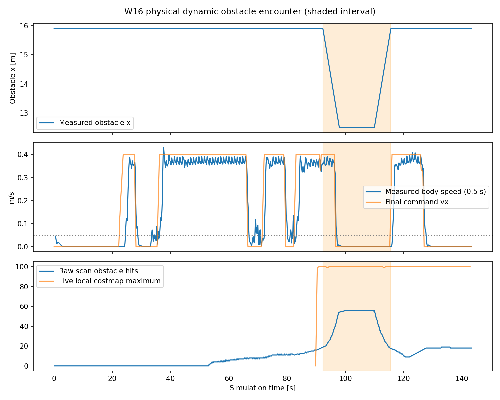

# Validation

The project records both navigation decisions and physical outcomes. Results below refer to their recorded source revisions. The GitHub packaging update changes documentation, packaging, and startup provenance checks.

## Full-mission video

The [October 23 recording](https://github.com/wandering2025/humanoid_nav_ws/releases/tag/demo-2026-10-23) shows MuJoCo and RViz together for the complete mission: six exploration targets, route discovery, a dynamic obstacle encounter, arrival, and standstill. The 2:19 video preserves wall-clock duration at 1× playback. Frames were captured during the mission; H.264 encoding ran after the simulator had exited.

The robot travelled **28.63 m**, waited **14.00 s** for the obstacle, and travelled another **6.27 m** after it withdrew. All **7 selected paths** passed checks against their contemporaneous costmaps. Maximum physical goal error in the final two seconds was **0.110052 m**, with zero contacts and falls. All components exited with code 0, and the DDS port was released.

The [recording verification](validation/full-mission-video.json) contains all **18 passing GUI audit checks**, component exits, video SHA-256, and capture timing. The 1920 × 900 MP4 contains 556 fully decoded frames at 4 fps, composed from 450 captured window pairs. Start, obstacle encounter, and arrival frames were visually reviewed.

Run: `20261023T093312Z_exploration_fb9164f4-88c9-438a-bf06-003371995c15`. Source: `7d7377941d7edb52590293ee5c4247c8f819c0f6`.

## Exploration reference run

The [graphical exploration run](validation/exploration-gui.json) starts with B=(+11.0,+0.5) m in frame A. Its six exploration targets and final approach form a measured **25.40 m** route. All seven selected paths passed replay checks against the costmaps captured when they were chosen.

| Check | Measurement |
| --- | --- |
| Moving obstacle | Collidable kinematic body; 6.8 m travel |
| Perception | 83 active LiDAR-hit frames; 37 marked local-costmap frames |
| Response | 17.72 s stationary wait, followed by 4.132 m travel |
| Arrival | Maximum final-two-second error 0.095193 m; stationary for 2.04 s |
| Physical outcome | Zero static, obstacle, and non-foot ground contacts; zero falls |
| Shutdown | Physical stop, all component exits zero, no owned processes left, DDS port released |

The [map audit](validation/obstacle-response.json) checks the final SLAM output at the former blockage: all 649 sampled cells are free. The [static control](validation/exploration-static.json) reaches B with 0.062906 m maximum final-window error and eight observed, reachable paths.

Showcase run: `20261019T220018Z_exploration_f55dc7ff-76c0-4473-af02-96b4fc3657a1`, source `0e2b302721fc11324f2392a20f6c892e7e7eac86`. The static control has byte-identical runtime source and its own recorded revision. Screenshots and the route plot are direct artifacts, with hashes in the [source index](validation/source-index.json).

## Layout adaptation

Two earlier static exploration runs use the same B and algorithm with passages on opposite sides of the occluding wall:

| Layout | Observed route | Final-window maximum error |
| --- | --- | ---: |
| [North passage](validation/north-layout.json) | Route reaches y=+8.36 m | 0.0915 m |
| [South passage](validation/south-layout.json) | Route reaches y=−8.08 m | 0.0835 m |

Each validates eight selected paths against contemporaneous observations. These runs demonstrate layout-dependent route discovery with a fixed task input.

## Saved-map navigation benchmark

The earlier saved-map stack completed **36 of 40** registered missions: static **10/10**, crossing **8/10**, blocking **8/10**, and sudden approach **10/10**. All 40 recorded zero environment contacts and falls. The [benchmark audit](validation/saved-map-benchmark.json) retains the original failed acceptance verdict: the crossing and blocking groups did not meet the registered 9/10 threshold. These measurements belong to saved-map navigation, separately from frontier exploration.

## Operating conditions and load tests

The measured platform is an indoor, flat-floor MuJoCo simulation with ideal odometry, truth-based attitude compensation, a finite-height LiDAR projection, and a kinematic moving obstacle. It provides a platform for studying humanoid navigation integration and reproducible scenario evaluation. Hardware deployment requires measured odometry and inertial inputs through the same interfaces.

The [local capture-load campaign](validation/load-tests.json) tested simultaneous GUI capture and CPU video encoding. On its final implementation, one loaded mission passed and the next triggered the unchanged 0.3 s scan timeout. A supplementary mission reached B and passed obstacle-response checks, then recorded a DDS shutdown exit of −11. The October 23 recording separates window capture from encoding and passes the complete mission and cleanup checks. It validates that recording workflow for this run; repeated-load reliability is tracked by the earlier campaign.

Both deliberate cancellation tests passed. Across all 20 attempts in that investigation, physical stop and process/port cleanup completed, with zero contacts and falls. The attempts span multiple revisions and are not pooled into a success rate.

## Reproduction

Use [setup and commands](setup.md) to run a new mission. Inspect `final-result.json` for the overall verdict, individual component exits, arrival error, and contact counts. Keep the full run directory when comparing algorithm or configuration changes.

The JSON files are selected historical records. Host workspace prefixes are normalized to `$WORKSPACE`; metric values, verdicts, and revision identifiers are preserved. References inside those records to raw logs identify development-archive artifacts, rather than files bundled in the public source snapshot.
